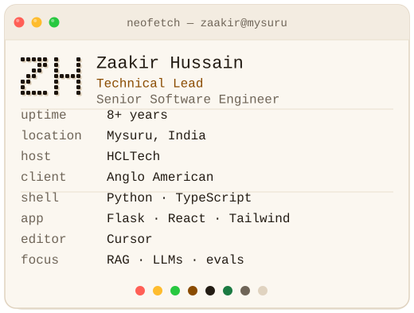

<p align="center">
  <picture>
    <source media="(prefers-color-scheme: dark)" srcset="assets/terminal-header-dark.svg">
    
  </picture>
</p>

<p align="center">
  <strong>Zaakir Hussain</strong><br>
  Technical Lead · Senior Software Engineer<br>
  Mysuru, India · 8+ years
</p>

I like the part where an ambiguous problem turns into a system a person can rely on. Right now that system is an AI copilot.

<p align="center">
  <picture>
    <source media="(prefers-color-scheme: dark)" srcset="assets/neofetch-dark.svg">
    
  </picture>
</p>

## Now

`$ cat ~/work/copilot.log`

At **HCLTech**, on assignment for **Anglo American**, I build custom AI, RAG, and LLM solutions. The product is an AI copilot. Briefs usually start ambiguous, and a lot of the work is with the people who use it.

**Flask** (Python) on the backend. **React, TypeScript, and Tailwind** on the frontend. Tracing, observability, and logging are a big part of the work.

**~30% less RAG ingestion load**, from classifying images and skipping OCR that isn't needed.

**500ms–1.5s added latency** on LLM-generated KPI charts.

**Eval pipeline** scores accuracy, relevance, and hallucination against ground-truth question sets, for document-backed answers and for answers backed by live telemetry.

## Stack

`$ ls ~/stack`

**Languages** — `Python` `JavaScript` `TypeScript`

**Backend** — `Django` `Flask` `Node.js` `Next.js` `REST APIs` `microservices`

**Frontend** — `React` `Vue.js` `Tailwind`

**Data** — `PostgreSQL` `MySQL` `MongoDB`

**Cloud** — `Azure` (current) · `AWS` (previous) · `Terraform` `Docker` `CI/CD` `Git`

**AI** — `LLMs` `RAG` `AI agents` `evals`

## How I work

`$ cat ~/how-i-work.txt`

**Cursor** is the daily driver. I use it for agentic coding: plan-and-execute loops, refactoring, performance work, and debugging. I also write the guides that help the team adopt it.

I mentor engineers through workshops, 1:1 trainings, and code review.

> Build simple solutions for complex problems.
> Focus on scalability, maintainability, and user value.

## Connect

[github.com/ZaakirHussain5](https://github.com/ZaakirHussain5) · [x.com/ZaakirHussain5](https://x.com/ZaakirHussain5)

Open to conversations about architecture, AI systems, and shipping useful products.

---

<details>
<summary><code>$ cat about.txt --verbose</code></summary>

The short version is above. This is the same story with the scrollback on.

I've spent 8+ years on backend systems, APIs, and full-stack products. The through-line is taking something complicated and leaving it simpler than I found it: scalable, maintainable, and worth a person's time.

The copilot is the current version of that. Retrieval, models, and enough tracing that we can see what the model actually did. I sit with the people who use it, because the requirements usually start as a conversation.

The eval pipeline is the part I am strict about. Accuracy, relevance, and hallucination, scored against ground-truth question sets. Document-backed answers go through it. So do answers backed by live telemetry.

Cursor stays open most of the day for plan-and-execute loops, refactors, performance work, and debugging, and the team guides sit next to that.

Mentoring, for me, is workshops, 1:1 trainings, and code review.

> I've spent years teaching computers what to do, and they still occasionally choose chaos.

</details>

<details>
<summary><code>$ sudo make coffee</code></summary>

```text
$ sudo make coffee
[sudo] password for zaakir:
make: *** No rule to make target 'coffee'.  Stop.

zaakir is not in the sudoers file.
this incident will be reported to the chaos module.
```

</details>

<details>
<summary><code>$ history | tail -n 5</code></summary>

```text
flask --app copilot run
python -m evals --score accuracy,relevance,hallucination
cursor --plan "skip the OCR we don't need"
git commit -m "trace the path we couldn't see"
sudo make coffee
```

</details>

<details>
<summary><code>$ cat banner.ans</code></summary>

ANSI Shadow, 43 columns.

```text
███████╗ █████╗  █████╗ ██╗  ██╗██╗██████╗ 
╚══███╔╝██╔══██╗██╔══██╗██║ ██╔╝██║██╔══██╗
  ███╔╝ ███████║███████║█████╔╝ ██║██████╔╝
 ███╔╝  ██╔══██║██╔══██║██╔═██╗ ██║██╔══██╗
███████╗██║  ██║██║  ██║██║  ██╗██║██║  ██║
╚══════╝╚═╝  ╚═╝╚═╝  ╚═╝╚═╝  ╚═╝╚═╝╚═╝  ╚═╝
```

</details>

<p align="center"><code>$ logout</code></p>

<p align="center">
  session closed.<br>
  computers still choose chaos.
</p>
